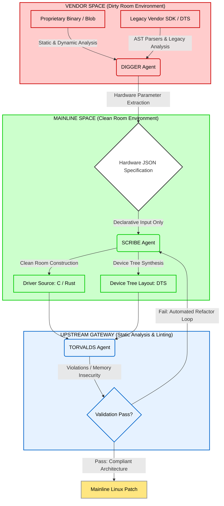

# Maline
An automated, multi-agent AI framework for refactoring legacy, closed-source vendor blobs into clean, modern mainline Linux drivers.
# Architecture and Core Workflow
Maline enforces an automated [Clean Room Design](https://en.wikipedia.org/wiki/Clean-room_design) methodology through a multi-agent pipeline. This architecture structurally isolates reverse-engineering processes from the code generation environment, passing only declarative hardware specifications between execution zones to eliminate proprietary copyright contamination.

### Functional Component Specification

*   **DIGGER Agent (The Extraction Subsystem):** Operates exclusively within the isolated *Dirty Room*. This agent executes static and dynamic analysis on proprietary kernel blobs and obsolete vendor SDKs. It is equipped with a comprehensive instrumentation suite to interface directly with the target hardware, utilizing physical UART serial connections, SSH, Telnet, and embedded web configuration interfaces to capture runtime data and environment metrics. Its core task is to extract raw hardware operational metrics, including memory-mapped I/O (MMIO) boundary addresses, interrupt request lines (IRQs), register bitmasks, and clock distribution trees. The output is structured as a non-copyrightable, purely declarative **JSON Specification**.
*   **SCRIBE Agent (The Synthesis Subsystem):** Operates strictly within the *Clean Room* environment. It is completely isolated from, and has no visibility into, the original vendor binary code or proprietary SDKs, establishing legal immunity against copyright infringement. Utilizing only the functional requirements defined in the JSON Specification, it writes clean driver infrastructure from scratch using *C* or the *Rust for Linux* framework, alongside target-compliant [Device Tree (.dts)](https://en.wikipedia.org/wiki/Devicetree)
*   **TORVALDS Agent (The Validation Subsystem):** Functions as the automated code-review and quality gate. Programmed with the official Linux kernel coding style guidelines and historical upstream patch architectures, it processes Scribe's output via compiler diagnostics, and static analyzers. If it detects memory safety issues, insecure pointer arithmetic, or formatting non-compliance (such as space-based indentation instead of 8-character tabs), it rejects the patch and routes it back to Scribe for iterative refactoring. Compliant code is formatted into an upstream-ready *Mainline Linux Patch*.

All source code is licensed under the [GPL v2.0](https://www.gnu.org/licenses/old-licenses/gpl-2.0.en.html) 
